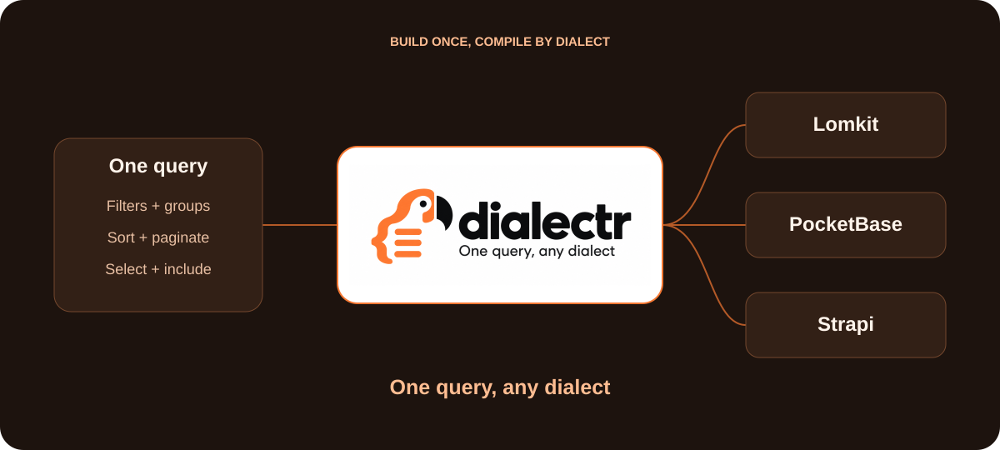

<p align="center">
  <a href="https://techmefr.github.io/dialectr/"></a>
</p>

<p align="center">
  <a href="https://github.com/techmefr/dialectr/actions/workflows/ci.yml"></a>
  
  
  <a href="LICENSE"></a>
</p>

<p align="center">
  <a href="https://techmefr.github.io/dialectr/"><b>Documentation</b></a> ·
  <a href="https://techmefr.github.io/dialectr/guides/query-builder/">Query builder</a> ·
  <a href="https://techmefr.github.io/dialectr/guides/adapters/">Adapters</a> ·
  <a href="https://techmefr.github.io/dialectr/guides/write-your-own-adapter/">Write an adapter</a>
</p>

# dialectr

**One query, any dialect**

A zero-dependency TypeScript query builder. Compose typed, immutable queries and compile them to Lomkit, PocketBase or Strapi through independent adapters.

```ts
import { query } from 'dialectr'
import { toLomkit } from 'dialectr-adapter-lomkit'
import { toPocketbase } from 'dialectr-adapter-pocketbase'
import { toStrapi } from 'dialectr-adapter-strapi'

const users = query<{ name: string; age: number }>()
  .where('age', '>=', 18)
  .orWhere('name', 'like', 'A%')
  .sort('name')
  .limit(20)
  .page(2)
  .build()

toLomkit(users)
toPocketbase(users)
toStrapi(users)
```

```ts
toLomkit(users)
// { search: { filters: [
//     { field: 'age', operator: '>=', value: 18 },
//     { field: 'name', operator: 'like', value: 'A%', type: 'or' }
//   ], sorts: [{ field: 'name', direction: 'asc' }], limit: 20, page: 2 } }

toPocketbase(users)
// { filter: "(age>=18) || (name~'A%')", sort: 'name', page: 2, perPage: 20 }

toStrapi(users)
// { filters: { $or: [{ age: { $gte: 18 } }, { name: { $startsWithi: 'A' } }] },
//   sort: ['name:asc'], pagination: { page: 2, pageSize: 20 } }
```

> **Keywords** — query builder · TypeScript · fluent API · immutable queries · query AST · compiler · backend adapters · filters · pagination · Lomkit · Laravel · PocketBase · Strapi · neXdk

## When it pays off

dialectr costs a dependency and an abstraction layer (about 14.5 kB minified for the core and the three adapters, against about 1.2 kB for two hand-written builders measured on one backend). It pays off from 2 backends, or from about 5 different query shapes on one resource. The more backends, the more it saves: one query is written once instead of once per backend.

With a single backend and few shapes (a filter on one field, a sort, a page), a hand-written function that builds that backend's parameters is shorter and has nothing to learn. Start there. Move to dialectr when a second backend appears or when the builders start to repeat the same filter logic.

## Packages

| Package | Role |
|---|---|
| [`dialectr`](packages/core) | The builder and the neutral `Query`. No runtime dependencies. |
| [`dialectr-adapter-lomkit`](packages/adapters/lomkit) | Laravel Lomkit `{ search }` payload. |
| [`dialectr-adapter-pocketbase`](packages/adapters/pocketbase) | PocketBase `filter`, `sort`, `fields`, `expand`, `page`, `perPage`. |
| [`dialectr-adapter-strapi`](packages/adapters/strapi) | Strapi v5 `filters`, `sort`, `fields`, `populate`, `pagination`. |

Nothing is published to npm yet. Build from source:

```bash
pnpm install
pnpm build
pnpm test
```

Node.js 22 or later.

## Builder

`query<T>()` returns an immutable builder. Field names are typed from `T`.

| Method | Effect |
|---|---|
| `where(field, value)` / `where(field, operator, value)` | AND condition, operator defaults to `=` |
| `orWhere(...)` | OR condition |
| `whereIf(field, [operator,] value)` / `orWhereIf(...)` | Like `where`, skipped when the value is `undefined`, `null`, `''` or `[]` |
| `when(condition, cb)` | Runs `cb(builder, condition)` and returns its chained result when `condition` is truthy, otherwise returns the builder unchanged |
| `whereGroup(cb)` / `orWhereGroup(cb)` | Nested group, empty groups are skipped |
| `sort(field, direction?)` | `'asc'` (default) or `'desc'` |
| `select(...fields)` | Fields to return |
| `include(relation, cb?)` | Load a relation, optionally constrained by a sub-query |
| `aggregate(type, relation, { field?, alias?, where? })` | `count`, `min`, `max`, `avg`, `sum`, `exists` |
| `search(text)` | Free-text search, non-empty, at most 1024 characters |
| `extend(target, value)` | Backend-specific options, see below |
| `limit(n)` / `page(n)` | Positive integers. `page(n)` without `limit(n)` makes `build()` and `to()` throw `page() requires limit()` |
| `build()` | Returns a validated, serializable `Query` |
| `to(compiler)` | `compiler(build())` |

Operators: `=` `!=` `>` `>=` `<` `<=` `like` `not like` `in` `not in`.

The value is typed from the field when `T` is given: `query<User>().where('age', '>=', 'abc')` and `where('name', 'like', 5)` do not compile.

| Operator | Value |
|---|---|
| `=` `!=` `>` `>=` `<` `<=` | The type of the field |
| `in` `not in` | An array of the type of the field |
| `like` `not like` | A string |

Without a type (`query()`) every value stays permissive. Fields outside the keys of `T`, such as nested `a.b`, are not accepted when `T` is given.

```ts
query<{ id: number }>().where('id', 'in', [1, 2, 3]).to(toPocketbase)
```

`to(compiler)` accepts any `Compiler<TOutput>`, that is `(query: Query) => TOutput`.

### AND before OR

`AND` binds tighter than `OR`, as in SQL. `a AND b OR c AND d` means `(a AND b) OR (c AND d)`.

```ts
const q = query().where('a', 1).where('b', 2).orWhere('c', 3).where('d', 4).build()

toPocketbase(q)
// { filter: '(a=1 && b=2) || (c=3 && d=4)' }
```

Use `whereGroup` to change the grouping:

```ts
const q = query()
  .where('active', true)
  .whereGroup(group => group.where('role', 'admin').orWhere('role', 'editor'))
  .build()

toPocketbase(q)
// { filter: "active=true && ((role='admin') || (role='editor'))" }
```

Builders are immutable: `group.where(...)` returns a new builder and leaves `group` untouched. The callback of `whereGroup`, `orWhereGroup`, `include` and the `where` option of `aggregate` must return the chained result. Returning the builder it received, or nothing, throws an error that says so, instead of silently dropping the group:

```ts
query().whereGroup(group => {
  group.where('a', '=', 1)
  return group
})

query().whereGroup(group => group.where('a', '=', 1).where('b', '=', 2))
```

The first call throws, the second is correct. To add conditions in a loop, reassign: `group = group.where(...)`.

### Optional filters

Building a query from optional inputs used to need a ternary and `.filter(Boolean)`. Use `whereIf` and `when`.

```ts
const filters = [
  status ? { field: 'status', operator: '=', value: status } : null,
  ids.length > 0 ? { field: 'id', operator: 'in', value: ids } : null,
].filter(Boolean)

query<Order>()
  .whereIf('status', status)
  .whereIf('id', 'in', ids)
  .when(search, (builder, text) => builder.search(text))
  .when(onlyMine, builder => builder.extend('lomkit', { scopes: [{ name: 'mine' }] }))
```

`whereIf` skips `undefined`, `null`, `''` and `[]`; `0` and `false` are real values. `where(field, 'in', [])` is unchanged: it still matches nothing. `when` follows the immutability rule: the callback must return the chained builder, otherwise it throws.

### Include and aggregate

```ts
const q = query()
  .select('id', 'name')
  .include('posts', posts => posts.where('published', true).sort('title', 'desc').limit(5))
  .build()

toLomkit(q)
// { search: { selects: [{ field: 'id' }, { field: 'name' }],
//   includes: [{ relation: 'posts', filters: [...], sorts: [...], limit: 5 }] } }

toStrapi(q)
// { fields: ['id', 'name'],
//   populate: { posts: { filters: { published: { $eq: true } }, sort: ['title:desc'], pagination: { pageSize: 5 } } } }
```

A dotted path loads a nested relation: `include('posts.comments', c => c.where('approved', true))` applies the callback to `comments`. Lomkit compiles it to `includes: [{ relation: 'posts', includes: [{ relation: 'comments', ... }] }]` and merges paths sharing a prefix. Strapi and PocketBase keep the dotted name.

PocketBase `expand` cannot be constrained: an `include` with a sub-query throws. A plain `include('posts')` works everywhere.

Aggregates are Lomkit only:

```ts
query().aggregate('count', 'posts', { where: posts => posts.where('published', true) }).to(toLomkit)
// { search: { aggregates: [{ relation: 'posts', type: 'count', filters: [...] }] } }
```

Lomkit names each result `relation_type[_field]` (`posts_count`, `posts_sum_views`). When several aggregates share type, relation and field, the adapter gives the later ones a unique `alias` (`posts_count_2`, `posts_count_3`) so they do not overwrite each other; pass `alias` to choose the name yourself.

PocketBase and Strapi throw `does not support aggregates`. An adapter never drops something silently.

## like

`like` and `not like` take a SQL-style pattern: `%` at the start and/or end, `\` to escape `%` and `_`.

| Pattern | Meaning | Lomkit | PocketBase | Strapi |
|---|---|---|---|---|
| `x%` | starts with | `like 'x%'` | `~'x%'` | `$startsWithi` |
| `%x` | ends with | `like '%x'` | `~'%x'` | `$endsWithi` |
| `%x%` | contains | `like '%x%'` | `~'%x%'` | `$containsi` |
| `x` (no wildcard) | contains, case-insensitive | `like '%x%'` | `~'%x%'` | `$containsi` |
| `a%b`, `a_b` | inner wildcard | passed through | passed through | error |

Wildcards in user input are not escaped for you. Wrap the literal part with `escapeLike`:

```ts
import { escapeLike, query } from 'dialectr'

query().where('title', 'like', `%${escapeLike('50%')}%`).build()
```

`escapeLike('50%')` gives `50\%`. Case sensitivity of `like` on Lomkit depends on your database and collation.

`escapeLike` relies on `\` as the LIKE escape character. That holds on MySQL and PostgreSQL. SQLite has no default escape character: through Lomkit on SQLite the `\` is a literal character and `escapeLike('100%')` matches nothing. On SQLite, avoid user input in `like` or pass it without `escapeLike` and accept that `%` and `_` stay wildcards. `like` is also ASCII-only case-insensitive on SQLite, and `$containsi` on Strapi with SQLite behaves the same way.

## Search and extend

`search(text)` stores free text. Lomkit sends it as `search.text = { value }`. PocketBase and Strapi throw `does not support free-text search`.

`extend(target, value)` carries backend-specific options. The target is an adapter name (`lomkit`, `pocketbase`, `strapi`). An adapter reads only its own target and ignores the others, so one query can carry options for several backends.

```ts
const q = query().search('john').extend('lomkit', { scopes: [{ name: 'active' }] }).build()

toLomkit(q)
// { search: { text: { value: 'john' }, scopes: [{ name: 'active' }] } }
```

- Lomkit merges `gates` (`create`, `view`, `update`, `delete`, `restore`, `forceDelete`), `scopes` (`{ name, parameters? }`) and `instructions` (`{ name, fields?: { name, value }[] }`), all typed. Any other key, such as `filters`, throws. Field names such as `title.keyword` (Scout) are passed through unchanged in filters and sorts.
- PocketBase and Strapi accept no extension for their own target: it throws.
- `getExtension(query, target)` reads an extension, returning `undefined` when absent.

## Values

- `string` (at most 4096 characters), finite `number`, `boolean`, `null`, `undefined` or a valid `Date`.
- `undefined` becomes `null`. `Date` becomes an ISO string on Strapi, `'2026-01-02 03:04:05'` (UTC, no milliseconds, Laravel's native `Y-m-d H:i:s`) on Lomkit, and `'2026-01-02 03:04:05.000Z'` on PocketBase.
- Lomkit on SQLite compares dates as text against the stored `Y-m-d H:i:s` value, which is why `Date` is not sent as ISO there: `2026-01-02T03:04:05.000Z` sorts after `2026-01-02 03:04:05` and breaks equality and `>=` on the exact boundary. MySQL and PostgreSQL accept the `Y-m-d H:i:s` form too. A string you pass yourself is sent as is.
- `null` on Strapi: `= null` becomes `$null: true` and `!= null` becomes `$notNull: true`. Any other operator with `null` throws.
- `in` and `not in` take an array of those values. `like` and `not like` take a string.
- An empty `in` matches nothing and an empty `not in` matches everything. PocketBase gets `1=0` and `1=1` (a bare `true` or `false` is rejected by the server). Lomkit rejects an empty list with a 422, so `in []` is sent as `value: [null]` (accepted, matches nothing) and `not in []` is removed from the filters. Strapi does not transport an empty array, so `in []` becomes `{ $and: [{ f: { $null: true } }, { f: { $notNull: true } }] }` (matches nothing) and `not in []` is removed.
- Removing `not in []` keeps the logic exact: in an `and` chain the condition disappears, but inside an `or` cluster the cluster is always true, so the whole expression (or the enclosing group) becomes true and its filters vanish. `where('a', 1).orWhere('b', 'not in', [])` therefore returns every row.
- PocketBase compares dates as text. Pass a `Date` so it is written with the space separator the server stores; an ISO string with a `T` is sent as is, and a comparison on the exact boundary then shifts.
- Objects, nested arrays, functions, `NaN` and `Infinity` throw.

```ts
query().where('deletedAt', undefined).where('createdAt', '>', new Date('2026-01-02T03:04:05Z')).to(toLomkit)
// { search: { filters: [
//   { field: 'deletedAt', operator: '=', value: null },
//   { field: 'createdAt', operator: '>', value: '2026-01-02T03:04:05.000Z' }] } }
```

## Validation and limits

`build()` returns a validated deep copy (a snapshot), and each adapter validates again through `prepareQuery`, so a hand-made `Query` object gets the same checks. Mutating a value after passing it in changes nothing.

`assertQuery(query)` and `prepareQuery(query)` return the validated copy and throw on anything invalid: unknown operator, bad direction, empty group, sparse array, forbidden key (`__proto__`, `constructor`, `prototype`).

Limits are exported from the core:

| Constant | Value | Applies to |
|---|---|---|
| `MAX_NODES` | 1000 | Shared budget: filters, sorts, selects, includes, aggregates, `in` list items and extension entries |
| `MAX_DEPTH` | 32 | Nested groups, includes and extension values |
| `MAX_LIST` | 10000 | Items in one `in` list (still counted in `MAX_NODES`) |
| `MAX_LIMIT` | 10000 | `limit()` |
| `MAX_PAGE` | 1000000 | `page()` |
| `MAX_FIELD_LENGTH` | 256 | Field, relation and extension target names |
| `MAX_VALUE_LENGTH` | 4096 | Strings and `like` patterns |
| `MAX_SEARCH_LENGTH` | 1024 | `search()` text |
| `MAX_EXTENSION_KEYS` | 32 | Extension targets per query |

Adapter name rules:

- Strapi: dot-separated segments matching `[A-Za-z_][A-Za-z0-9_]*`, so a field cannot start with `$` and smuggle in an operator. `include('*')` throws `Strapi wildcard include is not supported`.
- PocketBase: names match `[A-Za-z_][A-Za-z0-9_.:]*`. String values are escaped.

## Write your own adapter

An adapter is a pure function `(query: Query) => TOutput`. See [Write your own adapter](docs/src/content/docs/guides/write-your-own-adapter.md).

## Ecosystem

Same author, same spirit: small, simple, modular.

- [nexdk](https://github.com/techmefr/nexdk): a frontend SDK that talks to any backend through one grammar. Pass a compiled payload to a driver, for example `sdk.lomkit.users.get(toLomkit(users))`. dialectr does not depend on nexdk.
- [shamock](https://github.com/techmefr/shamock)
- [beepr](https://github.com/techmefr/beepr)

## License

MIT, see [LICENSE](LICENSE).
